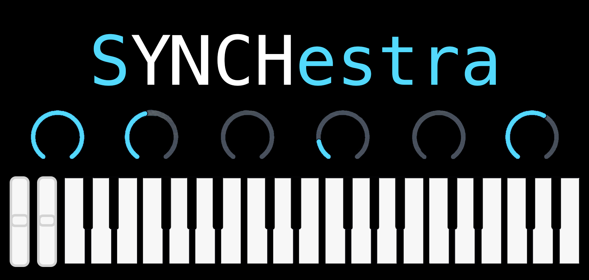

# SYNChestra



Record your instrument plugins into sample libraries. SYNChestra hosts a VST3 (or AU/LV2)
instrument, plays it note by note at several velocities, and saves the result as a
**Decent Sampler** (`.dspreset`), **SFZ** (`.sfz`) and **Floe** (`.floe.lua`) library: one set
of recordings, three formats, ready to open in Decent Sampler, [Floe](https://floe.audio),
sforzando, Sfizz, TAL-Sampler and other SFZ players.

The name is a tribute to Devin Townsend's *Synchestra*.

## Download

Get the latest version from the [Releases page](https://github.com/Sharkuel/SYNChestra/releases/latest):

| System | File |
| --- | --- |
| Windows | `SYNChestra-Windows-x64-Setup.exe` installs it with a Start menu entry; `SYNChestra-Windows-x64.zip` is the bare program |
| macOS | `SYNChestra-macOS.dmg`: drag SYNChestra into Applications |
| Linux | `.deb` (Debian, Ubuntu), `.rpm` (Fedora, openSUSE), or `SYNChestra-Linux-x86_64.tar.gz` for any distribution; Arch users install `synchestra` (this release) or `synchestra-git` (latest code) from the AUR |

The Windows and macOS builds aren't signed, so Windows SmartScreen and macOS Gatekeeper warn the
first time. On Windows choose **More info**, then **Run anyway**. On macOS, right-click the app,
choose **Open**, then **Open** again.

## Recording a library

Not sure what something does? Click **Help** (bottom right), then click any outlined button, box or
column heading to read what it does. Click Help again to turn it off.

1. **Find plugins** scans your plugin folders. Each plugin opens in a separate process, so one
   that crashes is just skipped.
2. Pick a plugin and press **Load plugin**. Its window opens: choose the sound you want there.
   Any connected MIDI keyboard plays it, so you can try it first.

   **Output** (top right) picks which of the plugin's outputs is heard and recorded. Multi-out
   plugins (drum kits, Kontakt) can send each instrument to its own pair: pick one to record just
   that. Outputs the plugin keeps off are listed once you choose **Turn on all outputs**.
3. Describe what to record in the table. Each row is a group:

   | Column | What it does |
   |---|---|
   | Record | Whether the row is recorded |
   | Name | The group's name, used for its folder and in the presets |
   | Lowest / Highest | The keys the group plays, as note numbers or names (C4 is 60) |
   | Every | A recording every this many keys. The sampler pitches each one to fill the keys between |
   | Layers | Velocity layers, spread evenly up to 127 |
   | Round robins | Takes of every note and layer, played in turn so repeats don't sound identical |
   | Hold (s) | How long each note is held before it's released. The recording keeps the release tail too |
   | Release (s) | How long the sampler fades a note after you let go of the key |
   | Pitched | Off for drums and effects: every key plays its own recording, unpitched |
   | One-shot | On for drums and hits: a recording plays to its end, whatever the key does |
   | Loop | Sustained recordings get a seamless loop, so a key can be held for as long as you like |
   | Channel | The MIDI channel the notes are sent on (10 for most drum plugins) |
   | Key-up | Also keep the sound of letting go of a key (dampers, fret noise, the room) and play it on key-up |
   | Keyswitch | A note (C1) or CC (CC32=10) sent before each note, to record one articulation |

   **Add keys** adds a keyboard range (a recording every 3 keys from C2 to C7 by default).
   **Add drum** adds a single unpitched one-shot note. **Listen** plays the selected row's middle
   note, held as it will be recorded. **Measure** holds the row's lowest note (it rings longest)
   for up to 20 seconds, then taps it, and sets the row to suit what it heard:

   - a note that keeps ringing after key-up (a drum, a pluck, a bell) becomes a one-shot, so each
     recording keeps its whole ring;
   - a note that dies away while held (a piano, a guitar) gets a Hold long enough to die away;
   - a note that sustains (a pad, an organ, strings) gets a 4 s Hold and Loop.

   Release is set to how long the note takes to fade after key-up.

   With **Loop** on, SYNChestra looks for a loop in the held part of each recording (after the
   attack, before key-up), picks the start whose sound best matches the end, and blends the two so
   the jump back can't be heard. The recording then stops at the loop's end; the sampler's Release
   fades it out after key-up. Notes that die away while held, and holds under a second, aren't
   looped. The loop is written to the .sfz, the .dspreset, the .floe.lua and the WAV file itself
   (FLAC files have no place for it). Recordings
   that aren't looped always keep the whole tail after the hold.

   The keyboard at the bottom plays the plugin on the selected row's channel, and shades that
   row's keys. **Find notes** plays every key once on that channel and marks the ones that make
   a sound with a green bar, so you can see which keys a patch uses (handy for drum kits and
   multi-sampled patches with gaps). It then offers to fill the table: each run of 4 or more
   sounding keys becomes a key row and lone keys become drums, or every key becomes a drum when
   the selected row is a drum or uses channel 10. You can replace the rows or add to them.

   Right-click a key to set it as the row's lowest or highest note, add a drum on it, set the
   row to the run of sounding keys around it, or add a new key row for that run. To draw a key
   row yourself, right-click its first key and choose **Start a new key row**, then right-click
   its last key and choose **End the new key row here**.
   **Key-up sounds.** With **Key-up** ticked, what the plugin plays after each note's key-up is
   also saved as its own sample (`..._rel.wav`, one per note and layer). The library plays it
   when a key is let go, and fades the held sound out quickly so the two don't double up.

   **Articulations.** To record a plugin's articulations (sustain, staccato, pizzicato...), add
   a row for each with the same keys, and type the plugin's keyswitch for it in **Keyswitch**: a
   note such as `C1`, or a CC such as `CC32=10` for plugins that switch with a controller. Each
   row is recorded after its switch. In the library, the first articulation plays to start with;
   Decent Sampler gets a menu to pick another and answers the same keyswitch notes, and the .sfz
   switches with the same notes (or CC values). Selecting a row also sends its keyswitch to the
   plugin, so the on-screen keyboard plays that articulation.
   **Skip same layers** (on by default) compares each velocity layer with the louder one kept
   before it. When the plugin only turned the volume down, the softer layer is left out, the
   louder recording covers its velocities, and the sampler plays it softer. Layers whose sound
   really changes (a brighter attack, a different articulation) are all kept.

4. Tick **Decent Sampler**, **SFZ**, **Floe** or any mix, pick the sample rate, and press
   **Record library**.

   For **Floe**, add the folder you save to as a library folder in Floe's settings (Floe looks
   through its subfolders). Each row becomes a Floe instrument of its own, since Floe has no
   keyswitches; round robins, loops, unpitched drums and key-up sounds carry over, and the
   panel's background picture becomes Floe's background. Release times and one-shots are set on
   Floe's own panel.

   Floe always shows its own controls, so a Floe library can only change Floe's look. In the panel
   editor, **Floe...** picks an icon for Floe's library list (cropped square, `Images/floe-icon.png`),
   a vignette colour that darkens the background picture's edges and a tint over Floe's panels;
   their see-through (alpha) slider sets how strong they are, so start low. The **Floe** button at
   the editor's top right (or opening **Floe...**) shows roughly how Floe will look with them;
   **Decent Sampler** goes back to the panel layout.

   **Try library** then plays what you just recorded from the on-screen keyboard and your MIDI
   inputs, the way a sampler would (key and velocity ranges, round robins, loops, release,
   key-up sounds and keyswitches), so you can hear it before opening it elsewhere. Click it again
   to go back to the plugin.

   The Decent Sampler panel has Volume and Release knobs. With **Effect knobs** ticked it also
   gets Tone (a low-pass filter), Chorus, Delay, Reverb and Room knobs, all off to start so the
   library sounds as recorded.

   **Panel...** opens the panel editor, which shows the panel at its real size (812 x 375).
   Decent Sampler draws its top bar over the top 40 and its keyboard over the bottom 85 of that,
   so the editor shades those strips: keep the controls between them.
   **Knobs...** ticks which knobs the panel has; a ticked one goes in a free spot. Each knob's
   job comes from its kind, whatever name it's given:

   | Knob | Turns | Range, start |
   | --- | --- | --- |
   | Volume | the library's level | 0 to 100%, 80% |
   | Release | how long a note fades after key-up | 0 to 5 s (or the row's Release), the row's Release |
   | Attack | how long a note takes to fade in | 0 to 10 s, 0 |
   | Pan | left to right | -100 to 100, centre |
   | Tune | the pitch, in semitones | -12 to 12, 0 |
   | Tone | a low-pass filter | 60 Hz to 22 kHz, open |
   | Chorus, Delay, Reverb | how much of each effect | off to full, off |
   | Room | the reverb's room size | 0 to 100%, 70% |

   Drag the title, knobs and articulation menu where you want them; click one to rename or
   resize it, right-click to remove it, and **Add...** adds the title, a line of text or the
   articulation menu.
   **Colours...** sets the background, text and knob colours, and **Background...** picks a
   picture, copied to `Images/background.png` and scaled and cropped to fill the panel.
   **Style** turns a knob into a vertical or horizontal fader; drag a fader's far end to
   lengthen it. **Standard layout** puts everything back. SFZ has no standard panel: the .sfz gets the
   Volume, Release, Attack and Pan knobs (CC7, CC72, CC73 and CC10) under the names given in the
   editor, which SFZ players list.

**Several sounds in one library.** To record many of a plugin's sounds in one go (all of a
Kontakt library's instruments or presets, say), set up the rows for the first one, then press
**Add sound**:

- **The sound it plays now...** keeps the plugin's settings under the name you give.
- **Presets from its list...** shows the presets the plugin lists (most synths list theirs): tick
  as many as you like, or **All**, and each becomes a sound named after it.
- **Catch each sound I pick in the plugin** is for plugins that don't list their presets, like
  Kontakt: click through the presets in the plugin's own window, a second or two apart, and each
  new one is added as Sound 1, Sound 2... (turning a knob counts as a new sound too). Choose it
  again to stop, and click a sound in the table to rename it.

A **Sound** column shows which sound each row records. Each new sound's rows start as copies of
the last sound's, to change as you like. **Record library** then
switches the plugin to each sound in turn, waits until it has loaded (until its middle note
plays the same twice running, up to three minutes) and records its rows into
`Samples/<sound>/`. Decent Sampler and SFZ get a preset per sound (`<Library> - <Sound>`), Floe
one library with an instrument per sound, and **Try library** plays the selected row's sound.
Click a row's sound to switch the plugin to it (for Listen, Measure and Find notes), rename it,
remove it with its rows, or move the row to another sound. Sounds are saved with the project.

**Projects.** **Project... > Save project** writes a `.synchestra` file with the rows, the
plugin and the plugin's own settings (the patch or kit picked in it). **Open project** brings
them all back, loads the plugin with that sound and opens its window, ready to record again or
add rows. Recording a library also saves its project next to it.

The library is saved in the **Save to** folder (Documents/SYNChestra by default):

```
My Library/
  My Library.dspreset
  My Library.sfz
  Samples/
    Keys/Keys_C2_v032.wav
    Keys/Keys_C2_v064.wav
    ...
```

With **Folder per format** ticked, each format gets a folder of its own inside Save to, each with
the samples: `Decent Sampler/My Library/`, `SFZ/My Library/` and `Floe/My Library/`. Point Floe's
library folder setting at `Floe/`. Where the disk allows, the copies are hard links to the same
files, so they take no extra space (and changing a sample in one folder changes it in all).

Samples are 24-bit stereo WAV files (or FLAC with **FLAC** ticked: the same sound in about half
the space, read by Decent Sampler, Floe and SFZ players), trimmed at the first sound and at the end of the tail,
with a short fade so they never click. A note that plays nothing is left out (the status line
names it) and its neighbours stretch over its keys.

## A library from samples you already have

**Project... > Make a library from samples...** turns a folder of WAV or FLAC files into the
same Decent Sampler, SFZ and Floe libraries, without a plugin. It uses the library name, the
ticked formats, Folder per format and the panel as recording does, and copies the files into
the library's `Samples` folder (hard links where the disk allows).

- Each folder inside the one picked becomes a row (files directly in it make a row named after it).
  Rows that play the same keys, such as `Sustain/` and `Staccato/`, get keyswitches from C1 up.
- The note comes from the file name: `C#4`, `Cs4`, `Db4` (C4 = 60), or a note number followed by a
  velocity (`Strings 60 127`). Without one, the WAV's own root note counts when the files differ.
- Velocity layers come from `v100` or `vel100` (the layers' top velocities), `vl2`, `layer2`,
  or `pp` to `fff`. Several files of a note with nothing to tell them apart are layered softest to loudest.
- `rr2`, `take2` or `seq2` make round robins; `rel` or `release` makes a key-up sample.
- A folder whose names have no notes is a drum kit: each sound (`Kick`, `Snare`, `Tom 2`) gets a key
  of its own from C2 up and plays to its end. `Kick_v1` and `Kick_v2` are layers of one drum.
- A pitched sample plays up to halfway to its neighbours; the lowest and highest reach half an octave
  further. Loops saved in WAV files are kept.

## Building from source

You need CMake 3.22+, a C++17 compiler, and on Linux the ALSA, X11 and FreeType development
packages. JUCE 8 is downloaded during the configure step.

```
cmake -B build -DCMAKE_BUILD_TYPE=Release
cmake --build build --config Release --target SYNChestra
```

The checks of the recorder and preset writers run against a stand-in synth:

```
cmake --build build --target SYNChestra_tests
build/SYNChestra_tests_artefacts/Release/SYNChestra_tests /tmp/synchestra-test
```

On Arch Linux, `cd packaging/aur/synchestra && makepkg -si` builds the latest release and installs it with its
menu entry; `packaging/aur/synchestra-git` builds the latest code instead.

## Licence

SYNChestra is free software under the GNU Affero General Public License v3 (see LICENSE),
the licence JUCE 8's free tier requires. It covers the app's code only: the libraries you
record with it are yours.

SYNChestra grew out of [eMIMICmkr](https://github.com/Sharkuel/eMIMICmkr), which records drum
plugins into Pearl Mimic Pro instruments, and shares its plugin host.
